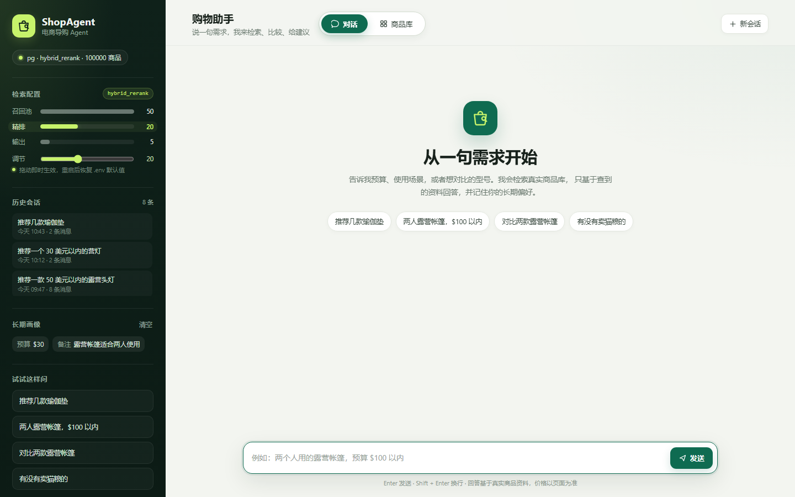
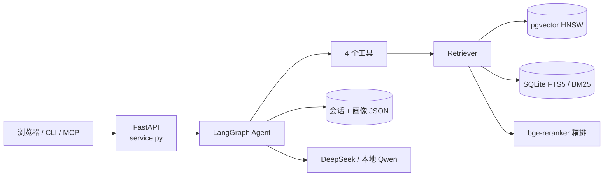

# ShopAgent · 电商导购 Agent

[在线 Demo](http://43.142.132.47:8000) · [评测报告](eval/eval_sets_overview.md) · [设计取舍](#7-设计取舍面试视角)

用一句中文说需求，Agent 判断意图、调用工具检索真实商品库，**只基于工具返回的数据**写推荐，
并把预算和偏好记到下一次对话。

- **检索**：10 万商品 / 159,874 chunk，向量 + BM25 双路召回 → RRF 融合 → cross-encoder 精排
- **Agent**：LangGraph 六节点状态机、4 个 Function Calling 工具、SSE 流式输出且可中断
- **评测**：检索 50+50 条双轨评测集、Agent 21 条确定性检查，指标与失败归因全部可复现



---

## 1. 它做什么，不做什么

**能做的事**

| 场景 | Agent 的行为 |
|---|---|
| 「推荐一款两人露营帐篷，$100 以内」 | 抽取预算 → 检索 → 基于商品资料推荐，并说明哪些未标价 |
| 「这两款哪个更合适」 | 调 `compare_products` 做 2–4 个商品并排对比 |
| 「这个有便宜点的替代吗」 | 调 `find_similar`，沿用当前预算 |
| 「再便宜点」 | 从会话历史理解指代，重新检索 |
| 「你好」 | router 直接走闲聊，不进入工具链 |

**明确的边界**

- 这是我个人的作品集项目，不是生产服务：**没有鉴权、单进程、会话存本地 JSON**，不要直接暴露在公网
- 商品库是 Amazon Reviews 2023 的 **Sports & Outdoors 单类别**随机抽样 10 万条，不是全量电商
- 语料是英文，中文 query 靠 planner 翻译成英文关键词（见 [§8](#8-已知限制)）
- 评测集是我自己构造的，**21/21 只代表满足这 21 条检查**，不能和公开 benchmark 横比

**技术栈**：Python 3.10+ · LangGraph · DeepSeek（OpenAI 兼容）· pgvector / SQLite FTS5 ·
bge-small-en-v1.5 + bge-reranker-base · MCP · FastAPI · Docker Compose

---

## 2. 架构



### 2.1 检索漏斗

```
商品 JSONL ──清洗──> 商品记录 ──切分──> chunk ──embed──> 向量索引（pgvector HNSW / numpy）
                                    └──> BM25 倒排（SQLite FTS5）

查询 ──┬─> 向量召回 top-50 ─┐
       └─> BM25 召回 top-50 ─┴─> RRF 融合 ─> 按 ASIN 去重 ─> 精排 top-20 ─> 输出 top-5
```

- 向量：`bge-small-en-v1.5`，384 维，L2 归一化后内积即余弦
- 融合：RRF（k=60），只看排名不看分数，避免 BM25 与余弦的量纲问题
- 精排：`bge-reranker-base` 对「query + chunk」逐对打分，只重排 RRF 前
  `SHOPAGENT_RERANK_CANDIDATES=20` 条；这个值可热改，原因见 [§4.3](#43-精排候选数扫描)
- 去重：同一商品有多个 chunk，统一按 ASIN 去重
- BM25 两套实现、同一接口：小语料用 `rank_bm25` 内存版；10 万语料用 FTS5 磁盘索引。
  16 万 chunk 下内存版实测占 **2.6GB**，会和模型抢内存，FTS5 只占几 MB

### 2.2 Agent 状态机

```
router ──chitchat───────────────────────────────┐
  ↓                                            │
recall（把本轮偏好写进画像）                      │
  ↓ shop / compare                             │
planner ──无工具调用────────────────────────────┤
  │ 有 tool_calls                              │
  ↓                                            │
tool_exec                                      │
  ↓                                            │
reflect ──还有步数 → planner                     │
  │ 步数用尽 / 全部失败                          ↓
  └──────────────────────────────────→ generate → END
```

| 节点 | 职责 | 为什么单独拆出来 |
|---|---|---|
| `router` | 判意图：shop / compare / chitchat | 闲聊不过工具链，省 token 也省延迟 |
| `recall` | 从**用户原话**抽偏好写画像 | 放在规划之前，本轮的预算立刻影响工具参数；只读原话，避免把「再便宜点」写进长期记忆 |
| `planner` | 决定下一步调哪个工具 | 只做决策不写答案，避免「边查边编」 |
| `tool_exec` | 执行工具，结果回填 | 工具异常转成 `{"error": ...}` 交给模型，不炸整个流程 |
| `reflect` | 规则判断：继续规划还是收尾 | 步数上限 4、工具全失败直接收尾；规则判断不额外调 LLM |
| `generate` | 只基于工具结果写答案 | 「依据哪些资料回答」只有一个出口 |

### 2.3 工具与记忆

| 工具 | 用途 |
|---|---|
| `search_products(query, max_price?, top_k?)` | 混合检索，可带预算过滤 |
| `get_product_detail(asin)` | 取单个商品完整描述 |
| `find_similar(asin, max_price?)` | 同类替代（「有没有更便宜的」） |
| `compare_products(asins)` | 2–4 个商品并排对比 |

实现和 schema 分开：函数在 `shopagent/tools/shop.py`，schema 在 `shopagent/tools/__init__.py`。
**同一份 schema 同时喂给 DeepSeek function calling 和 MCP**，不维护两套接口。

| 记忆层级 | 存什么 | 位置 | 生命周期 |
|---|---|---|---|
| 长期 | 预算、适用人群/场景、偏好品牌、避开项 | `data/user_profile.json` | 跨会话 |
| 短期 | 最近 10 轮（20 条消息） | `data/sessions/<id>.json` | 单会话 |

画像只有五个结构化字段，不上向量库（理由见 [§7](#7-设计取舍面试视角)）。

### 2.4 三条入口，一套逻辑

```
浏览器（web/） ──同源 HTTP──> FastAPI ─┐
CLI（06_agent_chat.py）───────────────┼──> run_agent（同一张编译后的图）
MCP（07_mcp_server.py）───────────────┘
```

HTTP 侧有两个额外约定：

- `/chat/stream` 用 `GRAPH.stream` 逐节点取快照转发增量，**答案由同一个 `generate` 节点生成**，
  流式只改变传输方式，不改变 prompt 和答案
- `/chat` 与 `/chat/stream` 共用一把进程内锁串行执行：BM25 是懒加载的，并发首次请求会重复建索引。
  这个规模下串行比连接池划算；要横向扩展得先换共享存储

---

## 3. 快速开始

### 3.1 Docker（推荐）

```bash
git clone https://github.com/goldencorner/shopagent.git
cd shopagent

cp .env.example .env          # 填 DEEPSEEK_API_KEY
docker compose build api
docker compose up -d db

# ① 下载并抽样 10 万商品（完整类目约 4.1GB）
docker compose run --rm api python scripts/01_load_data.py --sample 100000 --seed 42

# ② 建索引：159,874 chunk，4 核 CPU 上 embedding 约 6–7 小时
docker compose run --rm api python scripts/02_build_index.py --store pg --recreate

# ③ 起 API + 前端
docker compose up -d api
```

打开 <http://localhost:8000>。第一次 `/chat` 还要下载 `bge-reranker-base`（约 1.1GB），
会等几分钟；之后的单轮检索对话约 13s。

**只想先跑通，不想等 6 小时**：把 ① 换成 `--limit 3000`，② 的耗时降到十几分钟。

### 3.2 本地开发

要求 Python ≥ 3.10（MCP SDK 要求；3.9 装不上 `mcp`）。

```bash
python -m venv .venv
# CPU 机器建议先装 CPU 版 torch，避免 pip 拉 CUDA 包
pip install torch --index-url https://download.pytorch.org/whl/cpu
pip install -r requirements.txt
cp .env.example .env          # 填 DEEPSEEK_API_KEY

docker compose up -d db
python scripts/01_load_data.py --sample 100000 --seed 42
python scripts/02_build_index.py --store pg --recreate
python scripts/10_serve.py    # 127.0.0.1:8000
```

没有 Docker 时全链路可以退到内存后端：`01_load_data.py --limit 3000` +
`02_build_index.py --store memory` + `10_serve.py --store memory`。

### 3.3 通过 MCP 调用

```bash
python scripts/07_mcp_server.py      # stdio
```

挂到 Claude Desktop（`claude_desktop_config.json`，路径必须是绝对路径）：

```json
{
  "mcpServers": {
    "shopagent": {
      "command": "/absolute/path/to/shopagent/.venv/bin/python",
      "args": ["/absolute/path/to/shopagent/scripts/07_mcp_server.py"],
      "env": {"SHOPAGENT_STORE": "pg", "SHOPAGENT_MODE": "hybrid_rerank"}
    }
  }
}
```

重启后直接问「帮我找两个人用的露营帐篷，50 美元以内」，它会调用这里暴露的 `search_products`。
工具层是标准协议，和 DeepSeek function calling 共用同一份 schema。

### 3.4 主要配置

| 变量 | 默认 | 说明 |
|---|---|---|
| `DEEPSEEK_API_KEY` | — | 必填；`DEEPSEEK_MODEL` 只能是 `deepseek-chat` / `deepseek-reasoner` |
| `SHOPAGENT_STORE` | `pg` | `pg` / `memory` |
| `SHOPAGENT_MODE` | `hybrid_rerank` | `bm25` / `vector` / `hybrid` / `hybrid_rerank` |
| `SHOPAGENT_RERANK_CANDIDATES` | `20` | 送进精排的候选数，1–50；页面滑块可热改 |
| `EMBED_MODEL` / `EMBED_DIM` | `BAAI/bge-small-en-v1.5` / `384` | 换 `bge-m3` 需改 `sql/schema.sql` 的维度并重建索引 |
| `RERANK_MODEL` | `BAAI/bge-reranker-base` | |
| `HF_ENDPOINT` | `https://huggingface.co` | 不要设 `hf-mirror.com`：它 308 重定向回官方站，新版 `huggingface_hub` 会抛 `FileMetadataError` |

---

## 4. 评测

### 4.1 两套 50 条评测集：为什么要双轨

| | 商品改写集（generated50） | 手写集（handwritten50） |
|---|---|---|
| 来源 | DeepSeek 读商品 description 后反写 query | 人工手写口语化 query |
| query 语体 | 商品文案式名词短语 | 使用场景 + 预算约束（英文） |
| 与目标标题的实词重合 | **44%** | **15%** |
| 与目标全文的重合 | **75%** | **52%** |
| query 中出现完整品牌名 | 1 条 | 0 条 |

生成集里有四分之三的实词能在目标商品原文里原样找到——指标天然偏高。
**两套一起报，才能看出「系统上限」和「没见过的问法下能到哪」。**
评测口径统一为 Hit@3（目标 ASIN 进前 3 名即命中），逐条排名与审阅表都在 `eval/`。

### 4.2 检索结果

pg 后端，10 万商品 / 159,874 chunk，CPU：

| 模式 | 生成集 Hit@3 | 生成集 MRR@3 | 手写集 Hit@3 | 手写集 MRR@3 |
|---|---|---|---|---|
| BM25 | 0.72 | 0.610 | 0.42 | 0.377 |
| 向量 | 0.52 | 0.470 | 0.18 | 0.100 |
| hybrid（RRF） | 0.62 | 0.550 | 0.34 | 0.287 |
| **hybrid + rerank** | **0.78** | **0.687** | **0.56** | **0.483** |

怎么读这张表：

- **精排是收益最大的一环**：手写集 0.34 → 0.56（**+65%**），生成集 0.62 → 0.78。
  rerank 只在已有的 20 个候选里重排，命中率却提升这么多，说明**候选池里本来就有正确答案，
  瓶颈在排序，不在召回**（这一条后面被失败归因推翻了一半，见 §4.4）
- **纯向量明显弱于 BM25**（手写集 0.18 vs 0.42）：运动品类 query 里品牌、型号、品类词密度高，
  词面匹配占优；语料越大，语义近邻越容易被同类目商品稀释
- **等权 RRF 反而拖累 BM25**（0.34 < 0.42）：两条召回通道质量差距大时等权融合不成立。
  这是下一步要改的地方（加权 RRF / 换更强的 embedding），不是删掉 hybrid
- 生成集与手写集的差距（0.78 vs 0.56）本身就是评测集偏置的量化结果

### 4.3 精排候选数扫描

同一套系统、同一批 query，只改 `RERANK_CANDIDATES`：

| 候选数 | 生成集 Hit@3 | 生成集 MRR@3 | 手写集 Hit@3 | 手写集 MRR@3 | 精排耗时 |
|---|---|---|---|---|---|
| **20（默认）** | **0.78** | **0.687** | **0.56** | **0.483** | ~1.9s |
| 30 | 0.74 | 0.660 | 0.54 | 0.477 | ~2.9s |
| 40 | 0.72 | 0.653 | 0.56 | 0.493 | ~3.8s |

扩大候选数救不回被截断的 query：手写集 20→40 救回 2 条、挤掉 2 条，净变化为 0；
生成集反而掉 3 条。**候选数翻倍，精排耗时线性翻倍，收益在噪声内**，所以默认 20。
精排耗时来自本机实测（约 96ms/对），部署机约 265ms/对。

### 4.4 失败归因：17 条未命中都去了哪

手写集 50 条里，精排后 33 条进 top-3，其余 17 条逐条核对：

| 情况 | 生成集 | 手写集 |
|---|---|---|
| 进了精排候选池（融合前 20） | 46 | 33 |
| 融合排名 21–50，被候选数截断 | 1 | 8 |
| 融合 top-50 里也没有目标 | 3 | **9** |

- 进了池子的 33 条，28 条最终进 top-3 —— **精排本身没问题**
- 8 条被 20 的候选数截断，但 §4.3 显示加大候选数并不能净赚
- **9 条（hw_03/07/17/23/25/31/36/37/42）在融合 top-50 里都没有目标** —— 真正的瓶颈是召回。
  这 9 条都是纯功能/场景描述，几乎不含商品品类词，需要跨词表改写才能命中：
  「cubes that get a campfire going」→ `Firestarter`、「strap-on weights for the lower leg」
  → `Ankle Weights`；`seven-and-a-half foot rod` 与 `7.6 Foot Rod` 还存在数字写法不一致

这条结论改变了优化方向：下一步不是继续调 rerank，而是查询改写（品类词归一、数字与单位归一）、
换中英双语的 `bge-m3`、或给通用品补可接受 ASIN。

### 4.5 Agent 级评测

`scripts/09_eval_agent.py`，21 条中文任务，跑完整图。**全部是确定性检查，没有让 LLM 当裁判**：

| 指标 | 结果 |
|---|---|
| 任务通过率 | **21/21** |
| 意图识别 / 工具选择 / 检索命中 | 2/2 · 15/15 · 14/14 |
| 预算合规 / 价格无幻觉 / 拒答正确 | 4/4 · 20/20 · 3/3 |
| 平均步数 / 平均 LLM 调用 | 1.10 步 / 4.95 次 |
| 端到端延迟 P50 / P95 | 13.8s / 24.1s |

任务构成：闲聊 2、单轮检索 8、预算约束 3、工具选择（详情/对比）3、拒答 3、多轮 2。

**100% 不代表性能够用**，它只说明这 21 条检查全部满足。可信度来自过程：

1. 检查是确定性的：工具名、标题正则、答案里的每个 `$数字` 是否来自工具输出，全部脚本判定
2. 切换品类后的首轮是 20/21，暴露的两个问题都修在 prompt 上，不是改检查：
   - 答案写了「Forceatt 贵约 $43」——差价不在商品资料里，属于编造。改为只比标价或比例，复测通过
   - 答案开头写「未按肤质/偏好筛选」——「肤质」是美妆时代的字段，运动商品没有。改为忽略无关字段
3. 代价也记录在案：拒答类任务走了 3 步 / 7 次 LLM 调用 / 23.1s，是 P95 的来源。
   **规则越硬，步数和延迟越高**

### 4.6 复现

```bash
# 检索：两套集子
python scripts/04_eval_retrieval.py --k 5 --hit-k 3 \
  --eval eval/retrieval_eval_generated50.jsonl --store pg
python scripts/04_eval_retrieval.py --k 5 --hit-k 3 \
  --eval eval/retrieval_eval_handwritten50.jsonl --store pg

# Agent：21 条任务
python scripts/09_eval_agent.py --store pg

# 各阶段耗时
python scripts/08_profile_latency.py --store pg
```

结果落在 `eval/results_*.json` / `eval/agent_results_*.json`。
**本仓库只提交了 README 中引用的几份**，其余按 `.gitignore` 忽略，避免把一次性输出当结论。

---

## 5. 延迟与成本

### 5.1 检索阶段耗时（本机 Ryzen 9 5900X，CPU）

| 阶段 | mean | p95 | 占比 |
|---|---|---|---|
| query embedding | 15.4 ms | 17.3 ms | 0.7% |
| BM25（SQLite FTS5） | 284.7 ms | 338.7 ms | 12.8% |
| 向量检索（HNSW，16w） | 5.3 ms | 6.7 ms | 0.2% |
| RRF + ASIN 去重 | 0.1 ms | 0.2 ms | ~0% |
| **cross-encoder 精排（20→5）** | **1916 ms** | **2194 ms** | **86.2%** |
| 合计 | 2221 ms | | 100% |

结论：**上 GPU 对向量检索没有意义**（5.3ms）；瓶颈是精排，优化顺序是
降候选数 → 调 batch → 量化/ONNX → GPU。试过但没采用的方案：

| 方案 | 速度 | 质量代价 |
|---|---|---|
| 输入截断到 768 字符 | 精排 −20% | Hit@3 0.875（40 条旧集） |
| 输入截断到 512 字符 | 快一半 | Hit@3 0.775 |
| int8 动态量化 | 快 1.5× | Hit@3 0.85 |
| bf16（CPU） | **慢 6 倍** | 部署机是 Zen 2，无 AVX512-BF16 |

### 5.2 端到端

腾讯云轻量 4 核 / 3.6GiB、10 万商品、精排候选 20 + batch 8：

| 场景 | 耗时 |
|---|---|
| 单次检索的对话（一次 search） | 约 13s |
| Agent 触发二次检索 | 约 20s |
| 首次 `/chat`（含两个模型加载） | 约 23s |
| 直接回答历史里的信息（不检索） | 约 2s |

其中每次检索 5–6s（精排占 95%），其余是 DeepSeek 的 router / planner / generate 调用（7–8s）。

**成本口径（诚实版）**：平均 4.95 次 LLM 调用/轮，按调用次数计，**尚未做 token 级计量**。
按 DeepSeek 的价格，单轮成本在「几厘到几分钱」量级，但没有实测数字就不写进结论；
token 统计与每日预算护栏在 Roadmap 里。

---

## 6. 工程化

- **测试**：`pytest tests` 共 **41** 个用例——价格过滤、pg `Decimal` 转 float、HTTP 各接口、
  SSE 失败不落盘、取消令牌、前端静态页、模型可用性探测
- **流式与中断**：SSE `step → token → done`；生成中点「停止」会断开模型流式连接，
  半截答案不写进会话。LangGraph 的 `stream` 是同步的，用 contextvar 把增量塞进队列，
  后台线程跑图、主生成器转发
- **两段式模型健康检查**：本地 Qwen 走 LM Studio 时，先问隧道代理 `GET /health`（1235）
  确认反向 SSH 隧道通，再读 `/api/v0/models` 的 `state=loaded`；两段都过才算可用。
  只读探测，不会触发模型加载；结果缓存 15s，`?refresh=1` 强制复查
- **热配置**：精排候选数可通过页面滑块或 `POST /config/rerank_candidates` 实时改，
  新请求立刻生效，进度中请求不受影响；重启回到 `.env` 默认值
- **商品明细不常驻内存**：offset 索引 + 3000 条 LRU，10 万条筛选首次 0.7–1.1s，翻页约 3ms。
  对照：3k 语料时代把商品整条放进字典，一轮对话后 RSS 约 2.5GiB；现在 10 万条版本
  API 常驻约 1.1GiB
- **会话/画像落盘**：CLI 聊到一半可以换浏览器接着问；`/sessions` 可列、可删，画像单独清空
- **部署**：`docker save` + `docker load` 离线部署；模型从 ModelScope 下到本地目录，
  `HF_HUB_OFFLINE=1` 后容器不再访问 HuggingFace

API 一览：

| 接口 | 作用 |
|---|---|
| `GET /` · `GET /static/*` | 浏览器 UI（零依赖 vanilla JS，无 npm / 无构建） |
| `POST /chat` · `POST /chat/stream` | 一次性 JSON / SSE 流式 |
| `GET /models` | DeepSeek 是否配了 Key、Qwen 两段探测结果 |
| `GET /sessions` · `GET/DELETE /sessions/{id}` | 会话列表 / 读取 / 删除 |
| `GET/DELETE /profile` | 长期画像 |
| `GET /catalog/stats` · `/catalog/products` · `/catalog/products/{asin}` | 商品库概览 / 搜索筛选分页 / 详情 |
| `GET /health` | 后端、检索模式、商品数、当前精排候选数 |
| `POST /config/rerank_candidates` | 热改精排候选数（1–50） |

---

## 7. 设计取舍（面试视角）

**Q：为什么不是纯向量检索？**
A：手写集上纯向量 Hit@3 只有 0.18，BM25 0.42。运动品类的 query 里品牌、型号、品类词密度高，
用户常常直接说「AA 电池头灯」，词面匹配天然占优。语料越大，纯向量的语义近邻越容易被
同类目商品稀释——所以是「按品类实测」而不是无脑上向量。

**Q：为什么要 RRF，而不是加权分数融合？**
A：BM25 分数和余弦相似度量纲不同，加权要标定两个系数且随语料漂移。RRF 只用排名，
k=60 是常用默认值，省掉一个需要调的参数。

**Q：RRF 融合后为什么反而比 BM25 差？**
A：手写集 BM25 0.42、hybrid 0.34。两条通道质量差距大时等权融合会把较弱的分支带进排序。
这不是 RRF 的问题，是权重不该相等。下一步是加权 RRF 或换更强的 embedding，
而不是删掉 hybrid——生成集上 hybrid 仍高于纯向量。

**Q：候选数为什么是 20？**
A：20/30/40 扫过：手写集 0.56/0.54/0.56，生成集 0.78/0.74/0.72；精排耗时线性上升。
加大候选数救回的 query 数量，与干扰项挤掉的相当。20 是拐点。

**Q：六个节点不就是 ReAct 循环吗？**
A：三点。① router 让闲聊不进工具链；② planner 只决策、generate 只生成，答案依据只有一个出口；
③ reflect 有明确步数上界和失败出口，裸 ReAct 在工具持续失败时会反复重试。

**Q：reflect 为什么不用 LLM 自我反思？**
A：一次反思调用 2–3s，规则能覆盖绝大多数情况（步数用尽、工具全失败）。真要做，
应该先有能量化收益的评测集。

**Q：记忆为什么不上向量库？**
A：画像是 5 个结构化字段，全量读取即可。会上向量记忆的是「片段多、需要模糊召回」的场景，
这里不成立。

**Q：中文 query 怎么检索英文语料？**
A：目前靠 planner prompt 要求翻译成英文关键词。这是补丁不是方案——`bge-small-en` 本身不认识中文。
正确修复是换 `bge-m3` 或加查询改写层；没做的原因是需要一组不含商品原词的中文 query 才能量出收益。

**Q：给了预算，为什么还返回没标价的商品？**
A：目录里 65.2%（65,197/100,000）的商品没有价格。严格过滤后，「$20 的瑜伽垫」只剩几款训练垫，
语义最匹配的恰好都没标价。现在的策略是：预算只作用于已知价格，未标价的保留并标注
`price_unknown`、排在预算内商品之后，由生成层写明「需自行确认」。
宁可多给一条带标注的候选，也不让用户看不到任何相关商品。

**Q：为什么工具异常不往外抛？**
A：Agent 和脚本的区别就在这里。工具失败转成 `{"error": ...}` 回给模型，让它换参数或换工具，
整轮对话照常完成。

---

## 8. 已知限制

1. **单类别、10 万条**：只覆盖 Sports & Outdoors，跨类目结论不适用
2. **评测集自建、样本 50+50 / 21**：1 条 query = 2pp，小数点后三位没有意义；
   两套集都只有 1 个 gold ASIN，通用品（哑铃、泡沫轴）前 3 名出现同质商品其实合理，会被判未命中
3. **没有语义忠实性评估**：「价格无幻觉」只核对数字，「材质/规格/场景是否编造」没有测
4. **中文检索靠翻译**：中文 query 的召回质量没有单独评测
5. **没有鉴权与限流**，会话存本地 JSON，单进程串行 —— 只能演示，不能当服务
6. **成本未做 token 计量**，延迟含公网 DeepSeek 调用

---

## 9. 目录结构

```
shopagent/
├── shopagent/
│   ├── config.py            # .env、离线模型检测
│   ├── llm.py               # DeepSeek：chat / chat_tools / chat_json
│   ├── embeddings.py        # bge-small-en-v1.5
│   ├── ingest.py            # 商品 → 文本 → chunk → 入库
│   ├── catalog.py           # 商品详情读盘 + 商品库检索/概览
│   ├── rag.py               # 裸 RAG（Week 1）
│   ├── retrieval/           # pgvector / numpy 后端、BM25、RRF、rerank
│   ├── tools/               # 4 个工具 + schema（DeepSeek 与 MCP 共用）
│   ├── memory/              # 长期画像 + 会话历史
│   ├── agent/               # state / nodes / graph
│   ├── service.py           # FastAPI：/chat /sessions /catalog …
│   └── web/                 # 零依赖前端（HTML/CSS/JS）
├── scripts/                 # 01 数据 → 02 索引 → … → 10 服务
├── tests/                   # 41 个 pytest
├── eval/                    # 评测集、审阅表、逐条排名、结果
├── sql/schema.sql           # pgvector 建表 + HNSW
├── deploy/                  # 国内云离线部署、Qwen 隧道代理
├── docs/                    # 截图
├── Dockerfile / docker-compose.yml
└── data/                    # 商品、索引、会话（gitignore）
```

---

## 10. 数据与许可

- 数据集：[Amazon Reviews 2023](https://amazon-reviews-2023.github.io/)（UCSD McAuley Lab，
  arXiv:2403.03952），只用 `meta_Sports_and_Outdoors.jsonl` 的**商品元数据**，没有用评论
- 10 万条是从整个类目里**蓄水池抽样**（`--sample 100000 --seed 42`），不能取前 10 万条：
  元数据的顺序和 ASIN/类目相关，前 N 条不是随机样本
- 官方未给出明确 license，个人学习/作品集使用没问题。**数据文件不随仓库分发**：
  `data/` 下所有语料、索引、会话都在 `.gitignore` 里，按 §3 自行生成
- 代码以 MIT 许可发布（见 `LICENSE`）

---

## 11. Roadmap

- [ ] 监控页：P50/P95 延迟、请求量、错误率、模型/隧道健康；域名 + HTTPS
- [ ] 评测集扩到 200–300 条、多类别、双人标注并报告 Cohen's κ
- [ ] token 级成本统计 + 每日预算护栏 + 按 IP 限流
- [ ] 召回优化：查询改写（预算/属性词拆解）、bge-m3 中英双语 AB
- [ ] 本地小模型实验：Qwen 1.5B QLoRA（query → 工具参数）+ 简单 DPO

---

## 12. FAQ

**`docker compose up` 报 `HCS_E_HYPERV_NOT_INSTALLED`**
BIOS 没开虚拟化（AMD 叫 SVM Mode）。不想重启就用 `--store memory` 跑 3000 条。

**跑 06/07 报 `No module named 'langgraph'` / `mcp`**
解释器低于 3.10 或装成了 mcp 2.x。`requirements.txt` 锁了 `mcp<2`（2.x 把 `FastMCP`
改名成 `MCPServer`），用 3.10+ 重装。

**第一次 `hybrid_rerank` 像卡住了**
在下载 `bge-reranker-base`（约 1.1GB），只有第一次。

**公网 demo 能直接放吗**
不能裸放：没有鉴权，任何人都能消耗 DeepSeek 额度。演示时至少要反代 + Basic Auth + 限流，
并接受单副本。

**想换支持中英的 embedding**
`.env` 改 `EMBED_MODEL=BAAI/bge-m3`、`EMBED_DIM=1024`，`sql/schema.sql` 的 `vector(384)`
改 `vector(1024)`，再 `02_build_index.py --recreate`。用同一套评测集对比两个模型，本身就是好素材。
